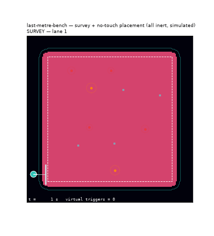
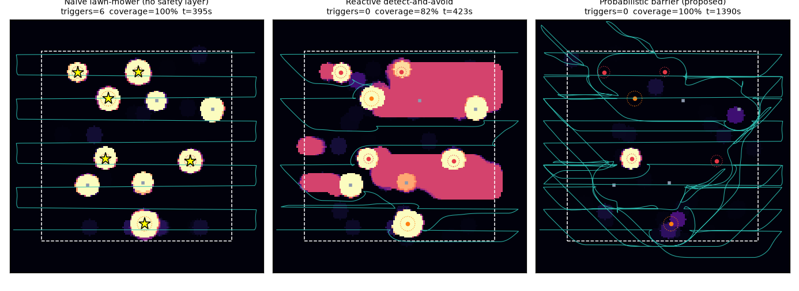
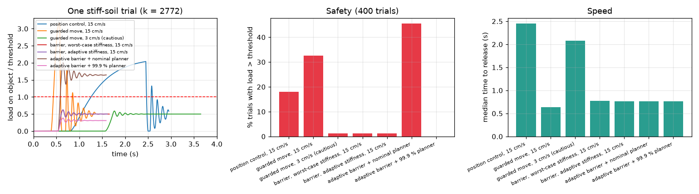
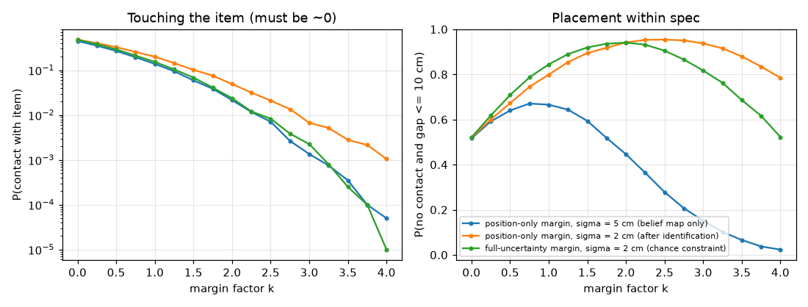

# last-metre-bench


**An open benchmark for safe autonomy in the "last metre" of humanitarian clearance of improvised landmines.** It covers survey on verified-safe ground, approach, **load-bounded no-touch placement** of a neutralisation unit, withdrawal, human initiation, and verification.



> Everything here is simulated and abstract. Items are inert surrogates described only by sensor contrast and geometry. The robot never touches, lifts or defuses an item and **cannot initiate anything**: a certified human operator decides and initiates (IMAS 09.31). No energetic materials or device details appear anywhere in this project. All load thresholds are normalised placeholders that a certified partner would set.

## Why
Improvised mines were the leading cause of mine casualties worldwide in 2024 (Landmine Monitor 2025). In Yemen, Project Masam renders improvised devices safe mainly by placing disruptors **by hand**; until July 2025 it had no mechanical assets (Mine Action Review 2025). IMAS 09.31 and the GICHD good-practice guide prefer that a robot place the tool, which makes the action *remote* rather than *semi-remote*. Today such robots are teleoperated without guarantees, and there is no shared benchmark or metric for this stage. Open datasets such as MineInsight, AMLID and SULAND_v2 cover perception only.

## What is in Stage A (this repo, pure Python, numpy only)
1. **C1: probabilistic barrier (CBF) on a Bayesian hazard map.** The robot may only drive where its own boom sensor has looked and found P(hazard under the footprint) ≤ ε. Unsensed ground is forbidden by construction. → [`docs/design.md`](docs/design.md)
2. **Survey.** Lanes are entered head-on with the sensor leading. A blocked lane is worked from the other end, as manual deminers do. A **mop-up** pass revisits pockets that only become reachable after neutralisation.
3. **The full last-metre chain:**
   - approach;
   - (abstracted) uncover + identify;
   - no-touch placement;
   - withdraw;
   - *operator decides and initiates (simulated)*;
   - verification after the old evidence is invalidated;
   - a **second look**: anything still detected where "clutter" was removed is treated as a device.
4. **C2 prototype: load-bounded placement** ([`lastmetre/contact.py`](lastmetre/contact.py)).
   - Lowering a unit next to a buried object must keep the load *transmitted through the soil* (Boussinesq) below a threshold at every instant.
   - The soil stiffness is unknown, and the robot must also allow for sensing delay and braking.
   - The method is a stopping-distance barrier with online stiffness adaptation, combined with a chance-constrained placement planner.
5. **Baselines:**
   - survey: `naive` (no safety layer); `reactive` (the *same* CBF on a binary map of threshold marks); `belief` (proposed);
   - placement: position control; guarded move (fast / cautious).

## Results

### Survey and chain (5 seeded 12 m × 12 m fields; 4 small + 2 large surrogate devices + 4 clutter items each)

**Survey**, 5 seeds (mean; triggers are totals):

| Policy | Virtual triggers | Coverage after survey | POD | Survey time (s) | Distance (m) |
|---|---|---|---|---|---|
| Naive lawn-mower (no safety layer) | 27 / 30 devices | 100% | 0.93 | 395 | 146 |
| Reactive detect-and-avoid (same CBF, binary map) | 0 / 30 devices | 83% | 0.83 | 445 | 124 |
| **Probabilistic barrier (proposed)** | 0 / 30 devices | 94% | 0.93 | 805 | 261 |

**Last-metre chain + mop-up** (proposed policy, all seeds):

| Devices processed | of which found only in the mop-up | Placed within spec | Contacts | Verification correct / wrong / inconclusive | Clutter & false alarms resolved | Devices missed at identification | of which re-flagged on second look | Coverage after mop-up | Triggers (whole mission) |
|---|---|---|---|---|---|---|---|---|---|
| 31 | 1 | 30 | 0 | 31 / 0 / 0 | 17 | 1 | 1 | 99.9% | 0 |

What the numbers say (and do not say):
- **Survey.**
  - Without a safety layer the robot drives over the trigger footprints of **27 of 30** devices. Both safety layers bring that to **0**.
  - With the **same CBF**, the belief representation reaches **94 %** coverage, against **83 %** for the binary map of threshold marks, whose fixed keep-out discs are large.
  - The price is about **2× survey time**: new ground is only entered head-on with the sensor leading, and blocked lanes are worked from both ends. Shortening that is open work.
- **After the chain and the mop-up:**
  - Coverage rises to **99.9 %**.
  - **29 of 30** devices were handled: 27 in the first pass, **1 found only in the mop-up** (in a pocket that was unreachable before neutralisation), and **1 recovered on the second look**.
  - That last device had been wrongly called "clutter" at the simulated identification step (5 % error model). It was not removed, the spot was re-sensed, it was still detected, and it was re-processed as a device.
  - One weak, deep device was never detected. The ε-guarantee is only as good as the sensor model, which is why calibrated sensing is part of the thesis.
- **Placement and verification:**
  - **0 contacts**; 30 of 31 placements were within the 10 cm spec (one at 10.7 cm).
  - The 31 placements include 2 clutter items wrongly called devices: a wasted unit, but safe.
  - **31 of 31** post-action verifications matched the truth.
  - **0 virtual triggers over the whole mission.**
- 5 seeds, idealised 2-D model: illustrative, not statistically powered.



### C2: load-bounded placement (400 Monte Carlo trials)
Soil stiffness varies 8× (soft to compacted sand). Surface height error σ = 1 cm, burial depth 3-10 cm, lateral error σ = 2 cm, sensing delay 10 ms, braking 1 m/s². Threshold θ is normalised by the unit's weight.

| Method | Trials where load on object > θ | Controller exceeded its force limit | Median time |
|---|---|---|---|
| Position control, 15 cm/s | 18 % | 317 / 400 | 2.45 s |
| Guarded move (stop at full weight), 15 cm/s | 32.5 % | 400 / 400 | 0.64 s |
| Guarded move, 3 cm/s (cautious) | 1.3 % | 0 | 2.08 s |
| Barrier, worst-case stiffness, 15 cm/s | 1.3 % | 0 | 0.77 s |
| Barrier, adaptive stiffness, 15 cm/s | 1.3 % | 0 | 0.76 s |
| Adaptive barrier + planner that ignores uncertainty | 45.5 % | 0 | 0.76 s |
| **Adaptive barrier + 99.9 % chance-constrained planner** | **0 %** | **0** | **0.76 s** |

- The barrier never exceeded its force limit, and it is **2.7× faster** than the cautious guarded move at the same safety level.
- The remaining 1.3 % comes from the planner's 97.5 % chance level. At 99.9 % there were **0 of 400** violations, for 2.5 cm more offset.
- Safety therefore requires *both* a correct controller *and* uncertainty-aware planning: an ideal controller with a nominal planner still fails 45 % of the time.
- In this model the stiffness adaptation gave no measurable speed-up over the worst-case bound. We report that as is.



**Placement-margin study** (`scripts/placement_study.py`). A fixed geometric margin cannot give both ≈ 0 contact and in-spec placement. This is why placement must be closed-loop and load-aware.



## Quick start
```bash
python -m venv .venv
.venv/Scripts/pip install numpy matplotlib pytest     # Windows  (Linux/macOS: .venv/bin/pip)
.venv/Scripts/python -m pytest -q -m "not slow"
.venv/Scripts/python scripts/run_benchmark.py --seeds 1 2 3 --gif 1     # survey + chain + mop-up
.venv/Scripts/python scripts/placement_load_study.py --n 400            # C2 prototype
.venv/Scripts/python scripts/placement_study.py                         # placement margin
.venv/Scripts/python scripts/make_table.py                              # README tables
```

## Roadmap
- **Stage B (Nov 2026):** ROS 2 **Lyrical Luth** and Gazebo **Jetty** (Ubuntu 26.04). The robot becomes a UGV with an arm placing a dummy unit, and the Stage-A core is reused inside ROS 2 nodes. → [`docs/stage-b-plan.md`](docs/stage-b-plan.md)
- **Instrumented inert surrogate:** open hardware with a load cell, an IMU and an ESP32 running micro-ROS. It logs force and tilt against a configurable "virtual activation" threshold, which gives a *measured* would-have-triggered metric.
- **Theory:**
  - discrete-time guarantees for the belief barrier;
  - load bounds through granular soil, using energy tanks and adaptive barrier states;
  - a supervisory controller mapped to IMAS hold points, with a provable human-initiation interlock.

## Limitations
See [`docs/design.md` §8](docs/design.md). In short:
- The models are 2-D (survey) and 1-D (placement) and idealised.
- Uncovering is abstracted, and Boussinesq assumes an elastic half-space.
- The results are illustrative, not statistically powered.

## Author
Fuad Ahmed A. Al-Shalabi — prospective PhD applicant, Systems & Control Engineering, KFUPM.

MIT licence.
